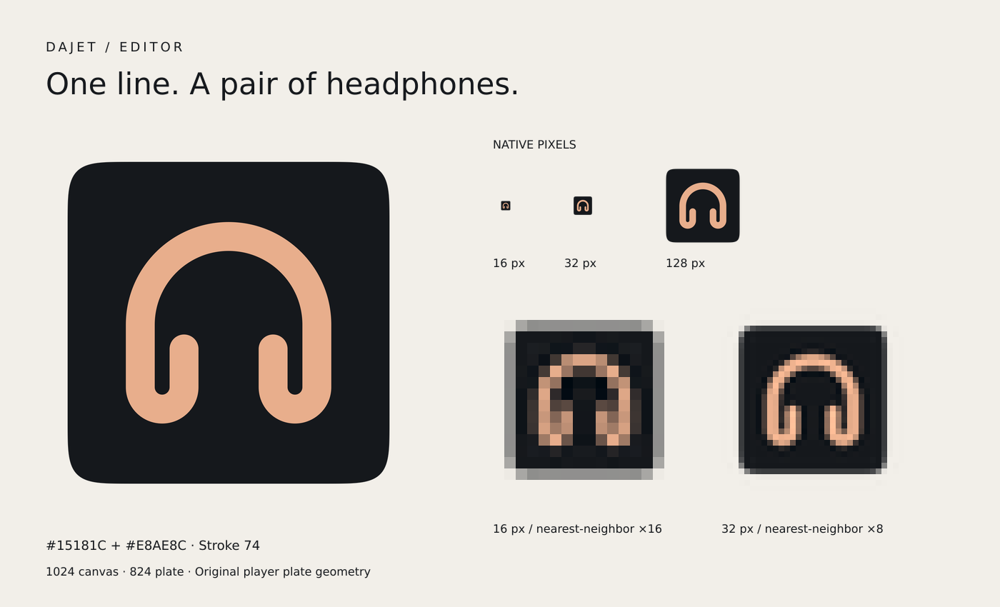

# Dajet Editor — знак и иконка

Материалы для `bestdeejay-design/dajet-editor#4`. По прямому указанию владельца
подготовлены **в `brand/signs/dajet-editor/`**, в ветке `arena/a4c2f38e-brand`, а не в редакторе.
База обновлена fast-forward до `main @ 2ce4c6c`: новый §7 канона требует
`signs/<ключ>/` и отделяет установку в приложение. `CONCEPT.md`, `palette.json`
и эталонные файлы не изменены относительно этой базы. Это комплект для
переноса: подключение к редактору и проверка на macOS ещё не выполнены.

## Выбор знака

Рекомендован один вариант: **наушники одним непрерывным штрихом**. Дуга оголовья
переходит в две чашки с открытыми внутренними концами; нет отдельных вставок,
декора и второй толщины. Силуэт симметричен и центрирован относительно (512, 512).
Вторая версия не нужна: этот вариант сохраняет узнаваемость в 16 px.

- Источник: [`icon.svg`](icon.svg), рядом с [`AppIcon.icns`](AppIcon.icns).
- Канва 1024 × 1024, плита 824 × 824, отступы 100.
- Контур плиты **дословно скопирован** из
  `signs/dajet-player/icon.svg`: суперэллиптические углы n = 5,
  `0.2253 × 824 = 185.6472` (точки эталона округлены до сотых).
- Два заданных цвета: `#15181C` и `#E8AE8C`.
- Один путь знака, один `M`, штрих 74, круглые концы и соединения.
- Нет `defs`, фильтров, градиентов, теней, декоративной обводки или opacity.
- Как у эталона, область канвы **вне плиты не закрашена**. Альфа на границе —
  сглаживание геометрии, а не полупрозрачный материал или свечение.

## Проверено глазами



Лист показывает натуральные 16 / 32 / 128 px и увеличение 16 / 32 px методом
nearest-neighbor без сглаживания. Светлый фон листа — только фон презентации,
не часть иконки. На 16 px сохраняются оголовье, центральный просвет и две
раздельные чашки; тонкие просветы внутри чашек закономерно упрощаются.
На 32 px внутренние окончания различимы; на 128 px линия чистая.

Отдельные кадры **из распакованного `.icns`**:

| Натуральный размер | Увеличение без сглаживания |
| --- | --- |
| [16 px](previews/icon-16.png) | [16 → 512 px](preview-16.png) |
| [32 px](previews/icon-32.png) | [32 → 512 px](preview-32.png) |
| [128 px](previews/icon-128.png) | — |
| [1024 px](icon-1024.png) | — |

## Воспроизводимая сборка

Node.js 22.12+ и npm; версия `sharp` зафиксирована в lockfile. macOS и `iconutil`
не требуются. Из корня репозитория:

```sh
npm ci
npm run icon:build
npm run icon:check
npm run icon:test
```

`tools/build-icons.mjs` растеризует SVG **один раз в 4096 × 4096**. Все размеры
получаются из этого мастера фильтром Lanczos3, без изменения штриха, ручных малых
версий, sharpening или квантования палитры. RGB интерполируется на матовом фоне
цвета плиты, альфа — отдельно: это предотвращает цветной шум при делении на
почти нулевую альфу внешней границы. Алгоритм одинаков для всех размеров.

Контейнер записывается кодом: заголовок `icns`, big-endian длины, десять PNG-записей.
Повторяющиеся физические размеры используют побайтово одинаковые PNG, но разные
типы записей для Retina. Превью извлекаются из уже собранного контейнера.

Для повторной сборки без перезаписи комплекта:

```sh
node tools/build-icons.mjs dajet-editor /tmp/dajet-editor-icon
cmp signs/dajet-editor/AppIcon.icns /tmp/dajet-editor-icon/AppIcon.icns
```

## Проверка контейнера

```sh
node tools/check-icons.mjs dajet-editor [путь/AppIcon.icns] [путь/icon.svg]
```

Скрипт проверяет сигнатуру, длину файла и каждой записи, отсутствие неизвестных и
повторных типов, ровно десять записей, PNG-размеры и каноническую структуру SVG.
Геометрия плиты закреплена SHA-256 её `d`, поэтому проверка переносима без копии
референса. Каждый распакованный растр сравнивается **по всем RGBA-пикселям**
с результатом единого рендера SVG. Изменение цвета, пустой растр или другой знак
не пройдут проверку даже при формально правильном заголовке.

Доли считаются от **всех пикселей канвы**, включая внешнее прозрачное поле.
Для сглаженного растра пиксель относится к цвету при `alpha ≥ 240` и евклидовом
расстоянии RGB `≤ 48` от соответствующего канонического цвета. Допуск не меняет
изображение. В выводе отдельно видны точные RGB-совпадения с `alpha = 255`.
Плита должна занимать минимум 20%, знак — минимум 0.5%; нарушение даёт `FAIL`
и ненулевой код завершения. Проверка продолжает печатать остальные записи.

Результат проверки этого комплекта:

| Тип | Логический размер | Растр | Плита, % | Знак, % |
| --- | --- | --- | ---: | ---: |
| icp4 | 16 @1× | 16 × 16 | 37.50 | 5.47 |
| ic11 | 16 @2× | 32 × 32 | 41.41 | 8.20 |
| icp5 | 32 @1× | 32 × 32 | 41.41 | 8.20 |
| ic12 | 32 @2× | 64 × 64 | 46.83 | 9.86 |
| ic07 | 128 @1× | 128 × 128 | 50.45 | 10.84 |
| ic13 | 128 @2× | 256 × 256 | 51.90 | 10.96 |
| ic08 | 256 @1× | 256 × 256 | 51.90 | 10.96 |
| ic14 | 256 @2× | 512 × 512 | 52.19 | 11.29 |
| ic09 | 512 @1× | 512 × 512 | 52.19 | 11.29 |
| ic10 | 512 @2× | 1024 × 1024 | 52.42 | 11.47 |

**Важно:** на 16 и 32 px нет пикселей с точным `#E8AE8C`: сглаживание смешивает
штрих с плитой, а округление может менять канал на единицу. Это не пустые записи:
проверены визуально, близкие к акценту пиксели присутствуют, полное совпадение с
рендером вектора подтверждено. Требование ровно двух цветов относится к заданным
цветам SVG, не к количеству оттенков антиалиасинга в PNG.

19 тестов нового инструментария проверяют правильный комплект и намеренные
повреждения: третий цвет, толщину, концы, opacity, defs, лишний путь, изменение
плиты, разрыв линии, ошибки контейнера, неверный размер, пустой/одноцветный растр,
подмену знака и ненулевой exit code. Это **не** 50 Swift-тестов редактора.
`npm audit` — 0 уязвимостей на момент проверки.

## Подключение в редакторе: две строки

В **этом** репозитории нет `build.sh`, `Package.swift`, `Sources/` и `Tests/`.
Состояние `build.sh` в редакторе не проверялось. Второй сборочный скрипт не создан.
Перенести `icon.svg` и `AppIcon.icns` в `assets/` редактора. В его существующий или
будущий `build.sh`, после создания `Contents/Info.plist` и **до подписи** бандла,
добавить следующие две строки. `$APP` здесь обозначает фактический путь к `.app`;
заменить на переменную сборщика. Рабочая директория — корень редактора.

```sh
if [ -f assets/AppIcon.icns ]; then mkdir -p "$APP/Contents/Resources" && cp assets/AppIcon.icns "$APP/Contents/Resources/AppIcon.icns"; fi
if [ -f "$APP/Contents/Resources/AppIcon.icns" ]; then /usr/libexec/PlistBuddy -c 'Set :CFBundleIconFile AppIcon' "$APP/Contents/Info.plist" 2>/dev/null || /usr/libexec/PlistBuddy -c 'Add :CFBundleIconFile string AppIcon' "$APP/Contents/Info.plist"; fi
```

При отсутствии исходной иконки копирование пропускается; на чистой сборке ключ
не добавляется. Наличие ключа в plist обрабатывается через Set, отсутствие — Add.

## Что остаётся до закрытия задачи редактора

- Перенести комплект в `dajet-editor`, подключить к его сборке.
- Запустить `swift build` и `swift test` до и после: здесь нет ни Swift, ни проекта.
- Проверить Finder и Dock на macOS; Linux-проверка контейнера этого не заменяет.
- В PR **редактора** добавить `Closes #4`. В PR репозитория `brand` эту локальную
  ссылку использовать нельзя: она указывала бы на другую задачу. Задачу редактора
  этот подготовительный комплект автоматически не закрывает.
